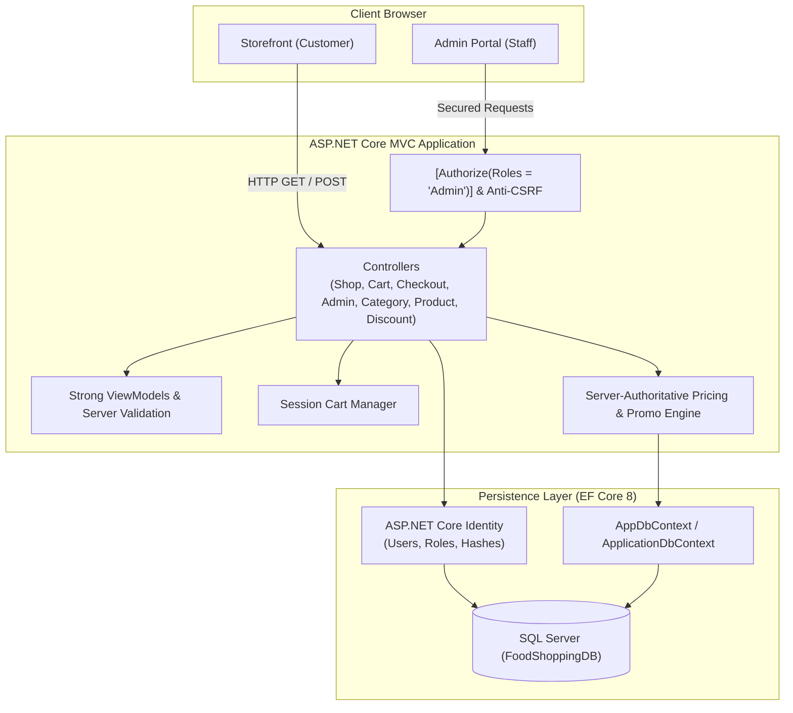
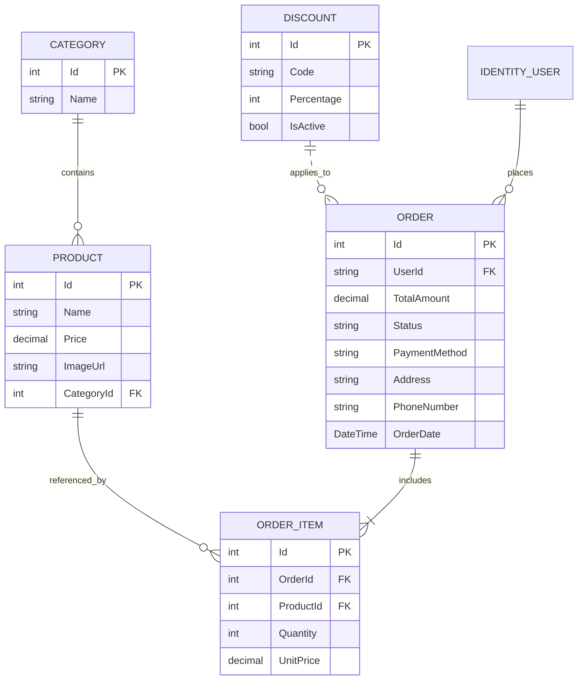

# FoodShoppingApp 🍔🛒
> A secure, production-grade ASP.NET Core 8 MVC E-Commerce platform for online food ordering, built with enterprise architectural standards, role-based authorization, and comprehensive unit tests.

[](https://dotnet.microsoft.com/)
[](https://learn.microsoft.com/ef/core/)
[](https://www.microsoft.com/sql-server)
[](https://xunit.net/)
[](LICENSE)

---

## 📌 Executive Summary

**FoodShoppingApp** is an end-to-end food ordering and storefront management system developed using **ASP.NET Core MVC** and **Entity Framework Core 8**. Originally built as an academic web application, the system has undergone a complete senior engineering transformation—hardening security vulnerabilities, enforcing server-authoritative pricing calculations, eliminating cascade deletion risks, implementing full administrative workflows, and adding a 42-test unit suite.

---

## 🏗️ System Architecture

The application adheres to clean Model-View-Controller (MVC) architectural separation, with centralized security policies, typed view models, and database-level transactional boundaries.



---

## 🚀 Key Features

### 🛍️ Customer Experience
- **Responsive Food Catalog:** Browse restaurant items with categorized tab filtering, instantaneous text search, and multi-tier sorting (by name, price ascending, and price descending).
- **Interactive Food Details:** View dish descriptions, prices, category badges, and dynamic related food items.
- **Session-Based Shopping Cart:** Real-time quantity adjustments (`+`/`-`), item removal via secure POST, item count badges in the navigation bar, and empty state illustrations.
- **Tamper-Resistant Checkout:** Cash on Delivery (COD) checkout where all item prices and promo codes are re-validated server-side against the database.
- **Printable Invoices & Receipts:** Clean, print-ready invoice layout with item breakdowns, discount accounting, customer delivery details, and browser print triggers.
- **Customer Order Tracking:** Account-specific order history page displaying order IDs, dates, status badges, and itemized receipts.
- **Account Management:** User registration, credential login with lockout protection, and CSRF-protected logout.

### 🛡️ Administrator Portal
- **KPI Metrics Dashboard:** Real-time summary cards displaying Total Revenue, Total Orders Placed, Active Catalog Products, and Registered Discounts.
- **Product Management:** Full CRUD suite with category selection dropdowns, price and image validation, and referential protection against deleting products with active order history.
- **Category Management:** Create, edit, and safely delete categories with duplicate name guards and child-product deletion locks.
- **Order Fulfillment Workflow:** Comprehensive order table with status badge indicators (`Pending`, `Processing`, `Delivered`, `Cancelled`), customer email search, status filters, and instant status updates.
- **Discount & Coupon Engine:** Create, activate/deactivate, and manage promotional codes with percentage discount rules.
- **Role Isolation:** Administrator dashboard, management endpoints, and admin registration are strictly guarded by `[Authorize(Roles = "Admin")]`.

---

## 🔒 Security & Data Integrity Hardening

During the engineering audit, several critical architectural and security risks were identified and resolved:

| Risk Area | Previous Insecure State | Hardened Production State |
| :--- | :--- | :--- |
| **Admin Registration** | Anonymous visitors could hit `/Admin/Register` and assign themselves the `Admin` role. | Secured behind `[Authorize(Roles = "Admin")]`, requiring an authenticated admin. Rollback deletion (`DeleteAsync`) executed if role assignment fails. |
| **Price Tampering** | Checkout form submitted hidden fields for `FinalTotal` and `DiscountAmount` that were trusted by the server. | **Server-Authoritative Pricing:** Client pricing inputs discarded. Products re-fetched from the database, line items calculated server-side, and discounts verified against active database records. |
| **Cross-Site Request Forgery (CSRF)** | Cart mutations, category deletions, and logouts executed over unsecured `GET` or unvalidated requests. | Converted all state mutations to `[HttpPost]` guarded with `[ValidateAntiForgeryToken]`. |
| **Data Inconsistencies** | Order items inserted outside atomic database transactions. | Wrapped in `await _context.Database.BeginTransactionAsync()` with automatic rollback on error. |
| **Duplicate Order Submissions** | Double-clicking or repeated form submissions could create duplicate orders. | Enforced session-based idempotency tokens (`CheckoutToken`) and UI submit button locking. |
| **Referential Integrity** | Deleting a product or category could crash or corrupt historical order records. | Injected foreign key integrity checks in `ProductController` and `CategoryController` preventing deletion of records tied to existing orders or items. |
| **Open Redirects** | Login redirects blindly followed unvalidated `ReturnUrl` parameters. | Sanitized redirect targets using `Url.IsLocalUrl(returnUrl)`. |

---

## 🗄️ Database Schema & Entities

The entity relationships mapped via Entity Framework Core:



---

## 🧪 Automated Testing Suite

The solution includes an independent **xUnit** test project (`FoodShoppingApp.Tests`) covering critical business logic:

```bash
dotnet test tests/FoodShoppingApp.Tests/FoodShoppingApp.Tests.csproj
```

### Test Coverage Highlights:
- **Cart Calculations:** Line item subtotal calculation, multi-item grand totals, and boundary quantity clamping (1–50 items).
- **Pricing & Discounts:** Accurate percentage deduction math, invalidation of inactive/expired coupons, zero-total floor protection, and rejection of client-side price manipulation.
- **Order Validation:** Order status whitelist verification (`Pending`, `Processing`, `Delivered`, `Cancelled`), rejection of malformed or script-injected statuses, positive price enforcement, and non-negative total guarantees.
- **View Model & Auth Validation:** DataAnnotation validation tests for password matching, length constraints, email formatting, and required field enforcement.

**Test Results:** `42 Passed, 0 Failed, 0 Skipped` (100% pass rate).

---

## ⚙️ Local Development Setup

### Prerequisites
- [.NET 8.0 SDK](https://dotnet.microsoft.com/download/dotnet/8.0)
- [SQL Server](https://www.microsoft.com/sql-server) (LocalDB, Express, or full instance)
- Visual Studio 2022 (v17.8+) or Visual Studio Code with C# Dev Kit

### 1. Clone the Repository
```bash
git clone https://github.com/Maruff-Ahmed/FoodShoppingApp.git
cd FoodShoppingApp/FoodShoppingApp
```

### 2. Configure Database Connection
Configure your SQL Server connection string in `appsettings.json` or via [.NET User Secrets](https://learn.microsoft.com/aspnet/core/security/app-secrets) (recommended for local development):

```json
{
  "ConnectionStrings": {
    "DefaultConnection": "Server=localhost\\SQLEXPRESS;Database=FoodShoppingDB;Trusted_Connection=True;MultipleActiveResultSets=true;TrustServerCertificate=True"
  }
}
```

### 3. Apply Migrations & Seed Data
If initializing a fresh database, apply the Entity Framework Core migrations:

```bash
dotnet ef database update
```

### 4. Seed the Initial Administrator
Because public administrator registration is disabled for security, the initial administrator account must be provisioned via SQL Server or an administrative seed script:

```sql
-- Ensure the Admin role exists in AspNetRoles
IF NOT EXISTS (SELECT 1 FROM AspNetRoles WHERE Name = 'Admin')
BEGIN
    INSERT INTO AspNetRoles (Id, Name, NormalizedName, ConcurrencyStamp)
    VALUES (NEWID(), 'Admin', 'ADMIN', NEWID());
END

-- Assign the Admin role to an existing Identity user
DECLARE @UserId NVARCHAR(450) = (SELECT Id FROM AspNetUsers WHERE Email = 'admin@foodapp.com');
DECLARE @RoleId NVARCHAR(450) = (SELECT Id FROM AspNetRoles WHERE Name = 'Admin');

IF @UserId IS NOT NULL AND @RoleId IS NOT NULL
BEGIN
    IF NOT EXISTS (SELECT 1 FROM AspNetUserRoles WHERE UserId = @UserId AND RoleId = @RoleId)
    BEGIN
        INSERT INTO AspNetUserRoles (UserId, RoleId) VALUES (@UserId, @RoleId);
    END
END
```

*(Subsequent administrator accounts can be created securely from within the authenticated Admin Portal at `/Admin/Register`.)*

### 5. Run the Application
```bash
dotnet run
```
Open your browser and navigate to `https://localhost:7000` (or the HTTP/HTTPS port shown in the console).

---

## 📂 Project Directory Structure

```plaintext
FoodShoppingApp/
│
├── Controllers/
│   ├── AccountController.cs         # Customer registration, login, logout
│   ├── CartController.cs            # Session cart management (POST only)
│   ├── CheckoutController.cs        # Server-authoritative checkout & orders
│   ├── HomeController.cs            # Landing page, privacy, error handling
│   ├── ShopController.cs            # Catalog browsing, search, sort, filter
│   └── Admin/
│       ├── AdminController.cs       # Admin dashboard & secured admin creation
│       ├── CategoryController.cs    # Category CRUD with referential protection
│       ├── DiscountController.cs    # Promo coupon management
│       ├── OrderController.cs       # Fulfillment & status management
│       └── ProductController.cs     # Food catalog CRUD
│
├── Models/
│   ├── AccountViewModels.cs         # Customer authentication view models
│   ├── AdminDashboardViewModel.cs   # KPI dashboard aggregates
│   ├── AdminLoginViewModel.cs       # Admin credential model
│   ├── CartItem.cs                  # Cart session item entity
│   ├── Category.cs                  # Menu category domain model
│   ├── Discount.cs                  # Promotional discount rules
│   ├── Order.cs                     # Order entity
│   ├── OrderItem.cs                 # Order line item entity
│   ├── Product.cs                   # Dish / menu item entity
│   └── ViewModels/
│       ├── CheckoutViewModel.cs     # Checkout submission model
│       └── ErrorViewModel.cs        # Diagnostics error model
│
├── Views/
│   ├── Account/                     # Modern customer login & registration views
│   ├── Admin/                       # Admin dashboard, order views, coupon manager
│   ├── Cart/                        # Interactive cart view
│   ├── Category/                    # Category CRUD views
│   ├── Checkout/                    # Checkout, printable invoice & order history
│   ├── Home/                        # Landing page
│   ├── Product/                     # Admin food management views
│   ├── Shared/                      # Navigation, footer, login partial
│   └── Shop/                        # Catalog grid and details
│
├── tests/
│   └── FoodShoppingApp.Tests/       # 25 xUnit automated test suites
│
├── wwwroot/
│   └── css/site.css                 # Clean, consolidated styling & responsive layout
│
├── Program.cs                       # Middleware, Identity, session & DI configuration
└── README.md                        # Portfolio documentation
```

---

## 🔮 Future Enhancements
- **Payment Gateway Integration:** Direct payment processing with Stripe, PayPal, or SSLCommerz webhooks.
- **Cloud Storage:** Transitioning food image uploads to AWS S3 or Azure Blob Storage.
- **Automated Email Notifications:** Transactional order confirmation emails via SendGrid or FluentEmail.
- **Live Order WebSockets:** Real-time kitchen-to-customer status streaming using ASP.NET Core SignalR.

---

## 📄 License
This project is open-source and available under the [MIT License](LICENSE).
